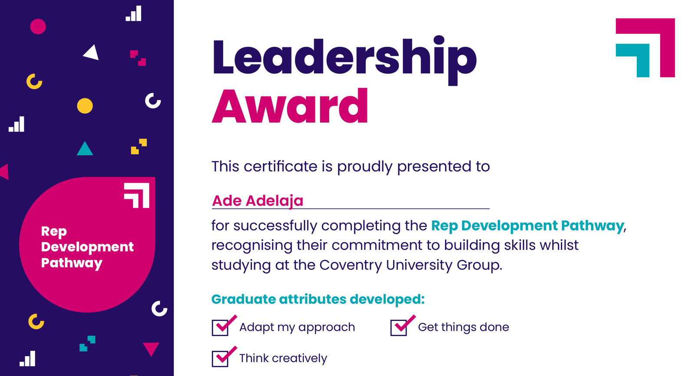

# Coventry University: the question nobody had asked

*Coventry University · Student Rep and Faculty Data Analyst · 2023 to 2024*

**Students said the timetable was stopping them getting in on time. I turned that into evidence a Head of School could act on.**

[Back to the portfolio](https://adeadelaja.github.io) · [All case studies](../README.md)

## The ask

Students kept saying the timetable was why they couldn't get in on time.

That's an anecdote. Anecdotes don't change timetables.

## What I did

**1. Collected.** I collected feedback across a faculty of more than 10,000 students, from surveys, course evaluations and meeting notes.

**2. Structured.** I structured it into categorised datasets so it could be counted, not just quoted.

**3. Tested.** With a team of course reps, I segmented it by department and year group and tested the timetable claim against the evidence, not against how loudly it was made.

**4. Presented.** I presented it to the Head of School and course directors.

## What came out of it

The pattern held, and the timetable changed. Students' union engagement rose 20% over the year, and I completed the Rep Development Pathway with the students' union Leadership Award.

## The evidence

*Leadership Award, Rep Development Pathway, 2023/24.*

## Not shown

Student feedback data, which is confidential.

## Skills

Survey analysis · Segmentation · Excel · Presenting to leadership · Stakeholder management
