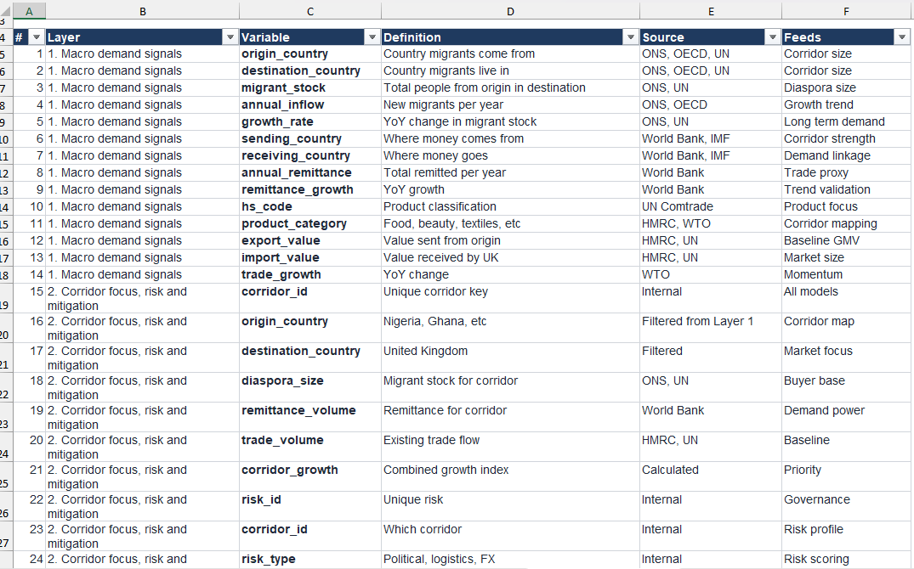
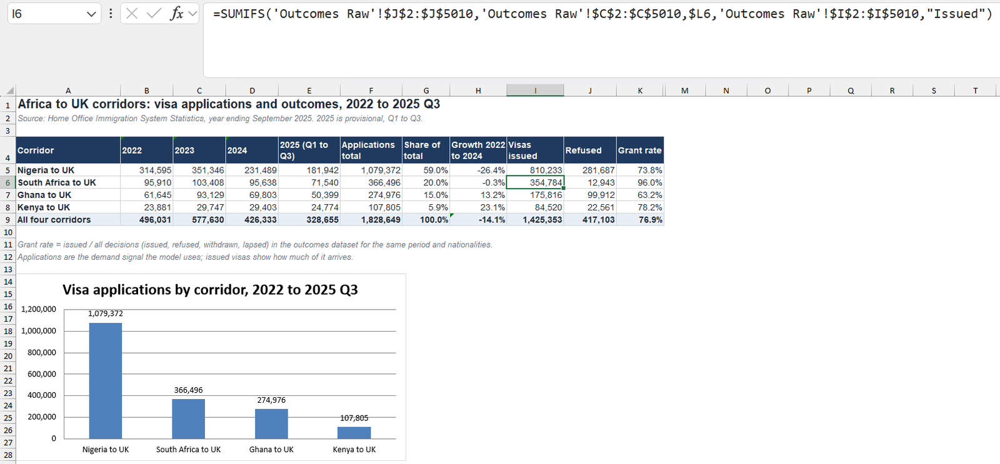
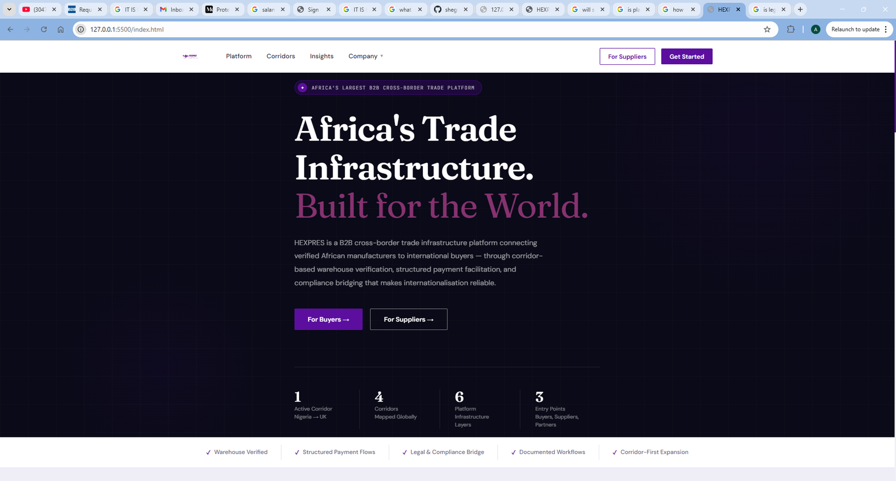

# Hexpres: a trade corridor model you only build once

*Harize Global · 2026 · Technical Business Analyst*

**Hexpres connects verified African manufacturers with UK buyers. I built the data structure every new trade corridor runs through.**

[Back to the portfolio](https://adeadelaja.github.io) · [All case studies](../README.md)

## The ask

Hexpres works one trade corridor at a time: Nigeria to the UK first, then Ghana, Kenya and Pakistan.

Every new corridor was turning into a new research project from zero, and the platform being built on top needed numbers it could trust.

## What I did

**1. Schema first.** I wrote a 29 variable data dictionary in two layers: macro demand signals, and corridor focus, risk and mitigation. Every variable has a definition, a source (ONS, OECD, UN, World Bank, IMF, HMRC) and the model it feeds.

**2. Data.** I pulled 2,616 Home Office records: 1.83 million visa applications from Nigeria, South Africa, Ghana and Kenya between 2022 and 2025. I built them into a demand model by corridor, year and visa route, and an activation model that turns diaspora population into likely buyers.

**3. Team.** I wrote the briefs the team worked from: an analyst brief to take four new corridors (Pakistan, Iran, Afghanistan and Tajikistan to the UK) through the same structure, an operations brief for asset light warehousing, a design handover with a locked design system, and a seven phase build roadmap.

**4. Platform and AI.** I led the MVP website build in VS Code with an AI coding agent. Every session had one task and one rule: don't touch any other file or section. I also wrote the company's AI usage policy: six gates any AI supported work has to pass, with every final decision owned by a person.

## What came out of it

A new corridor became a data refresh instead of a research project. The analysts were briefed to replicate the logic, not reinvent it.

The public version of the model in this folder adds the visa outcomes alongside the applications: 1,425,353 visas issued across the four corridors, a 76.9% grant rate.

## The evidence

*The 29 variable data dictionary.*

*Applications by corridor and year, with issued visas and grant rate.*

*The MVP website.*

## The files

* [Hexpres_Corridor_Model_PUBLIC.xlsx](files/Hexpres_Corridor_Model_PUBLIC.xlsx): Public data file: Home Office Immigration System Statistics and ONS figures as published. Private tabs removed.

GitHub can't open Excel or Word files in the browser. Use the download button on the file page to open them.

## Not shown

The business plan, partnership agreements and the funding allocation.

## Skills

Data modelling · Data dictionary design · Public data (Home Office, ONS) · Excel · Briefs and handover · AI usage policy · AI agent scoping
