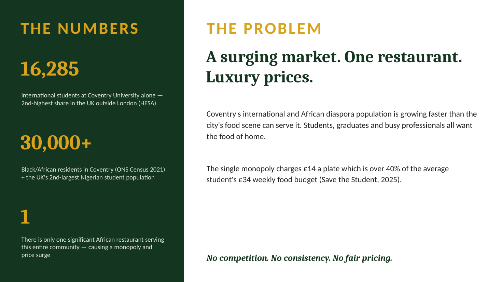
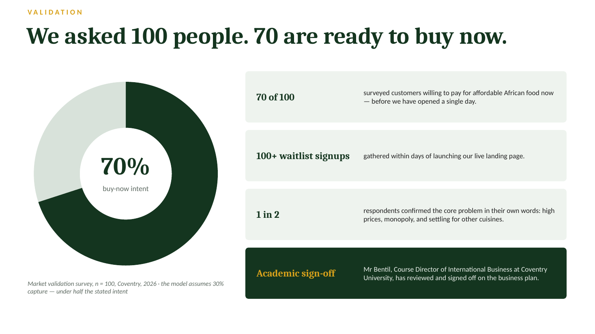
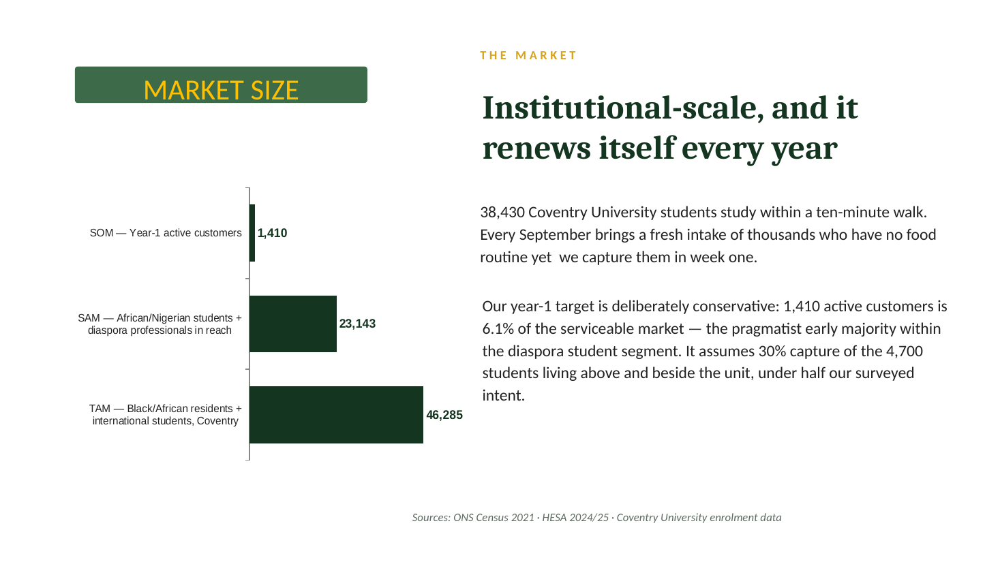
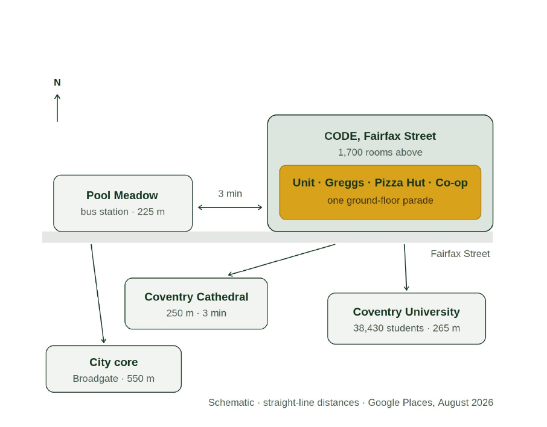
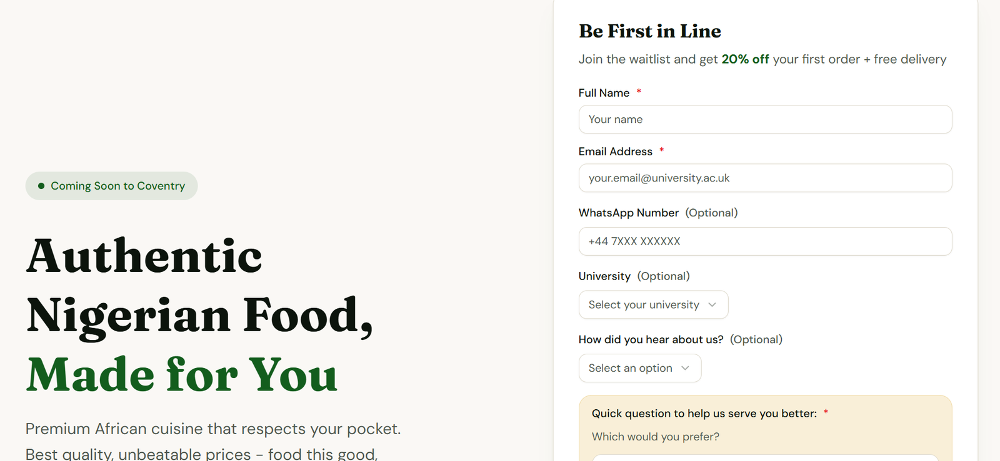
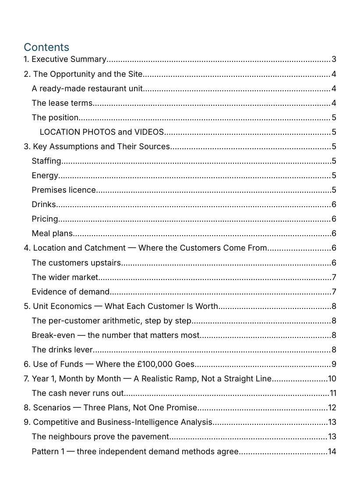

# Naija Delight: a restaurant, taken apart before a pound was spent

*Harize Global · client engagement · 2026*

**A founder needed £100,000 to open an African restaurant in Coventry city centre. I built the evidence an investor could check, line by line.**

[Back to the portfolio](https://adeadelaja.github.io) · [All case studies](../README.md)

## The ask

The founder had run a hospitality business before and could see the demand. Students and young professionals wanted good African food, and the only real option charged £14 a plate.

But instinct doesn't raise £100,000. It needed a proven customer, a site that made sense, a compliance position and numbers that agreed with each other.

## What I did

**1. Customers.** We surveyed 100 people in the target market and 70 said they would buy now. One in two said they couldn't get quality African food at a fair price and settled for other cuisines. A live waitlist page collected over 100 sign ups within days.

**2. Price.** That set the position: £10 a plate against £14. 29% cheaper, and still a healthy margin on every plate.

**3. Site.** I assessed the unit: a 1,296 sq ft former coffee chain unit beside the city's main bus station, with a commercial kitchen already fitted, a 1,700 room student building directly above and 38,430 university students within a ten minute walk.

**4. Catchment.** I built the catchment into the financial model as its own tab: 46,285 people in the market, 23,143 within realistic reach, and a target of 1,410 regular customers. That's one person in sixteen, so the plan doesn't depend on winning the whole market. I checked demand three independent ways before trusting it.

**5. Council.** I approached Coventry City Council before the numbers were final, separately to Licensing and to Food and Safety, because they cover different things. Licensing confirmed the fees and rules in writing: no premises licence needed at launch, and for the alcohol phase a 28 day consultation, a notice on display for the full 28 days and a newspaper advert within ten working days. I turned that into a compliance budget with one off and recurring costs.

**6. Investment pack.** A ten tab financial model with three planning scenarios, an investment memorandum written for a non specialist investor where every figure points back to a tab in the model, and an investor deck. Before it went out, I audited every slide against the model and fixed what didn't match.

## What came out of it

A £100,000 investment case where every number traces back to a source: the survey, the site, the council or the model. An investor can question any line and get an answer.

## The evidence

*The opportunity in three numbers.*

*70 of 100 ready to buy.*

*From 46,285 people to 1,410 regular customers.*

*The site and what surrounds it, from the memorandum.*

*The live waitlist page.*

*The investment memorandum: eleven sections, every figure traced to the model.*

## The files

* [Naija_Delight_Council_Compliance_Budget_CLEANED.xlsx](files/Naija_Delight_Council_Compliance_Budget_CLEANED.xlsx): Council compliance budget. Personal names removed; the council fees are public figures.

GitHub can't open Excel or Word files in the browser. Use the download button on the file page to open them.

## Not shown

The financial model and the memorandum's figures, which belong to the client, and the survey responses.

## Skills

Primary research · Pricing · Location analysis · Financial modelling · Regulatory compliance · Investment memorandum · Deck audit
