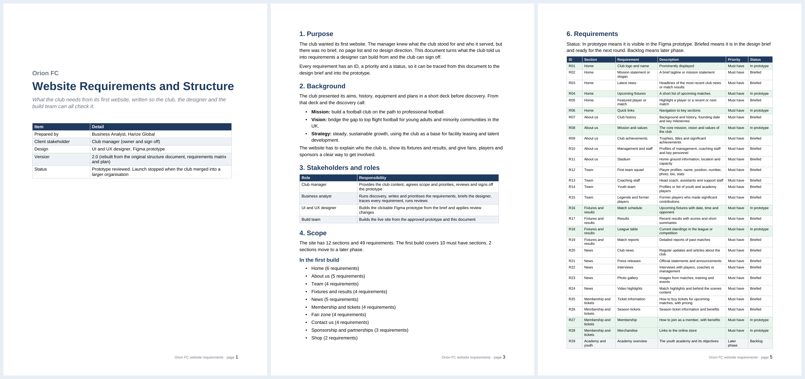
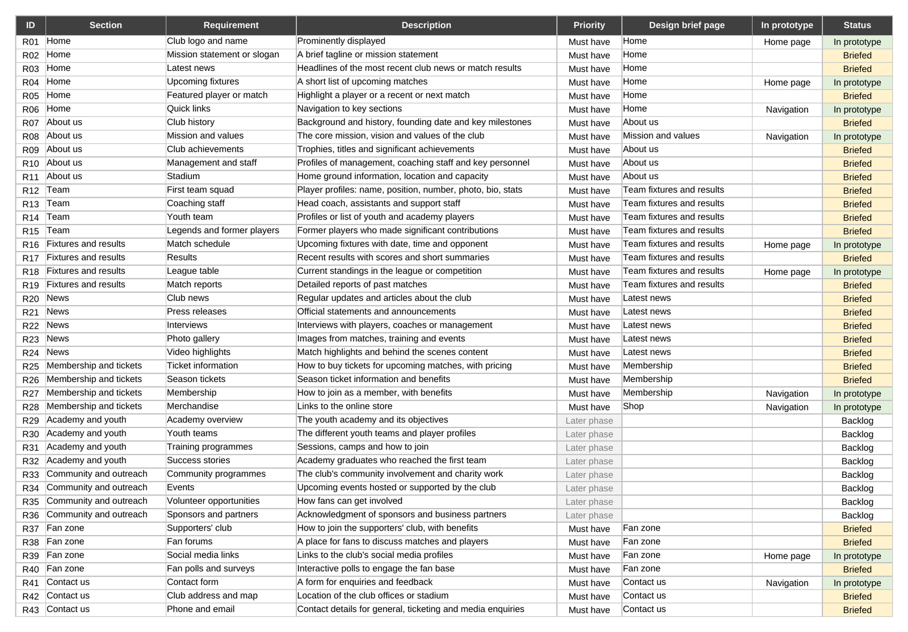
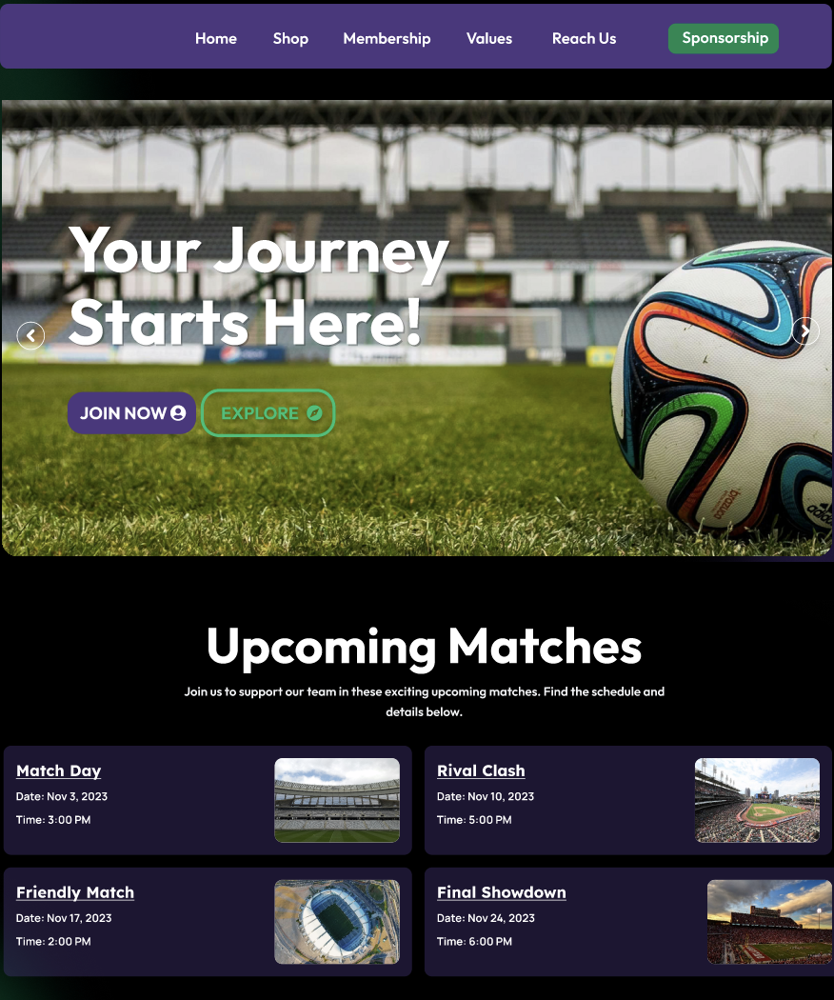

# Orion FC: building what the club actually asked for

*Harize Global · client project · Technical Business Analyst*

**A football club wanted its first website and had no brief. I turned what the manager knew into something a designer could build.**

[Back to the portfolio](https://adeadelaja.github.io) · [All case studies](../README.md)

## The ask

The club's manager knew what the club stood for and who it served.

But there was no brief, no page list and no design direction, so the designer had nothing to work from.

## What I did

**1. Discovery.** I ran the discovery with the manager and collected the club's mission, vision, values and history from the deck the club had prepared.

**2. Requirements.** I wrote the website requirements: 12 sections and 49 requirements, each with an ID, a priority and a status, in language both sides could check.

**3. Scope.** I agreed a first build of 10 must have sections and moved 2 (academy and youth, community and outreach) to a later phase.

**4. Design brief.** I briefed the UI and UX designer with the page list, the brand palette and the club's content, and traced every requirement through to the prototype in a requirements matrix.

**5. Review.** I ran the prototype review with the manager and turned the feedback into tasks for the designer.

## What came out of it

A clickable prototype the club reviewed and directed, with 12 of the 49 requirements already in it and the rest briefed and ready.

The launch stopped when the club merged into a larger organisation, so the requirements and the prototype are the delivered work.

## The evidence

*The website requirements document.*

*All 49 requirements traced to section, priority and prototype status.*

*The prototype home page.*

## Links

* [View the clickable prototype in Figma](https://www.figma.com/proto/SYXzT3MBEUSkhEs4Te6b5S/Shegs-Coventry-Club?page-id=0%3A1&node-id=2-2&viewport=306%2C120%2C0.25&t=HsAmrJUgzu6F23SR-1&scaling=min-zoom&content-scaling=fixed&starting-point-node-id=2%3A2&show-proto-sidebar=1)

## The files

* [Orion_FC_Website_Requirements.docx](files/Orion_FC_Website_Requirements.docx): The requirements and structure document.
* [Requirements_and_Project_Plan.xlsx](files/Requirements_and_Project_Plan.xlsx): Requirements matrix, scope summary and plan.

GitHub can't open Excel or Word files in the browser. Use the download button on the file page to open them.

## Not shown

Chats with the club and the team.

## Skills

Stakeholder discovery · Requirements · Scope prioritisation · Requirements traceability · Design briefing · Prototype review · Figma
