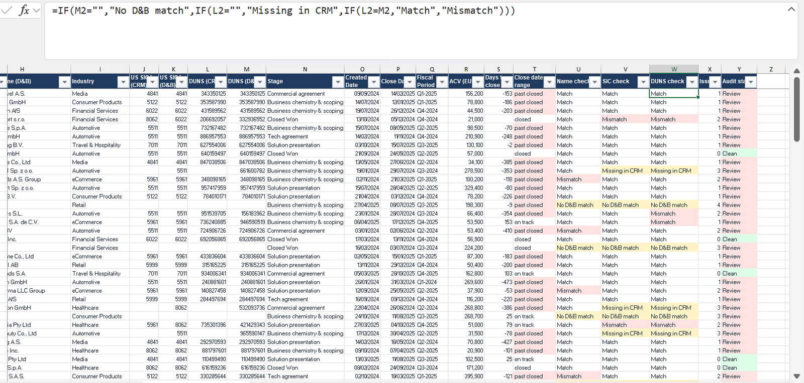

# SAP Emarsys: a pipeline compliance file that updates itself

*SAP Emarsys · Revenue Operations Analyst (12 month placement) · Oct 2024 to Oct 2025*

**I owned the file that kept the global pipeline honest: every new business record checked against the source everyone trusted.**

[Back to the portfolio](https://adeadelaja.github.io) · [All case studies](../README.md)

> **Cleaned file:** real names, figures and records are replaced with synthetic data of the same structure. The tabs, columns and formulas are the real work.

## The ask

After the SAP and Emarsys merger, the same pipeline lived in two systems that didn't always agree.

Account names, SIC codes and DUNS numbers drifted away from D&B Hoovers, the trusted source, and new opportunities kept arriving every week.

## What I did

**1. Owned the file.** I owned the pipeline compliance file and built it so it updated itself.

**2. Matched every refresh.** Every refresh pulls the rolling pipeline and matches each opportunity against the existing compliance file with advanced Excel formulas: XLOOKUP brings back the audited account data, and ISNA flags anything new that hasn't been audited yet. Around 800 lookups run on each refresh.

**3. Checked every record.** Each record is checked for account name, SIC code and DUNS number against D&B, and its close date against today, so stale deals show up too.

**4. Wrote it down.** The refresh and audit steps live inside the file, so anyone could run it.

## What came out of it

711 records across 693 accounts, 51 opportunity owners, 7 SAP regions and 9 fiscal quarters, kept in one place. New records flagged themselves for audit instead of waiting for someone to notice.

## The evidence

*Every record checked against D&B, formula bar visible. Synthetic records, real structure.*

## The files

* [SAP_Pipeline_Compliance_CLEANED.xlsx](files/SAP_Pipeline_Compliance_CLEANED.xlsx): The compliance file, rebuilt with synthetic records. Uses INDEX and MATCH so it opens in any Excel; the original used XLOOKUP.

GitHub can't open Excel or Word files in the browser. Use the download button on the file page to open them.

## Not shown

Anything from SAP's systems: account names, owners, IDs and values.

## Skills

Advanced Excel · XLOOKUP / ISNA · D&B Hoovers · Salesforce · Data reconciliation · Process documentation
