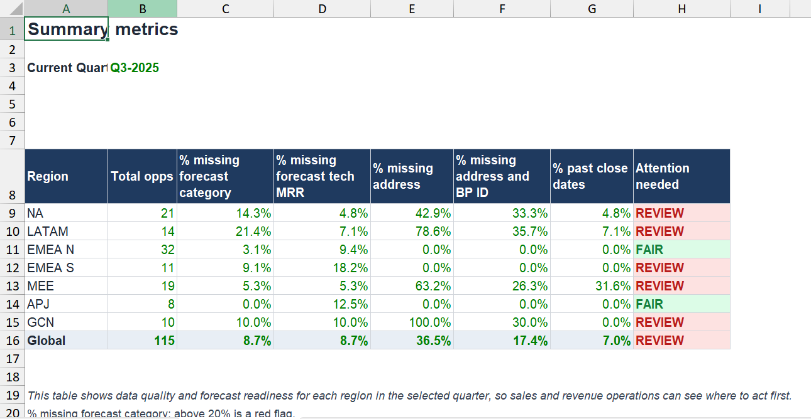
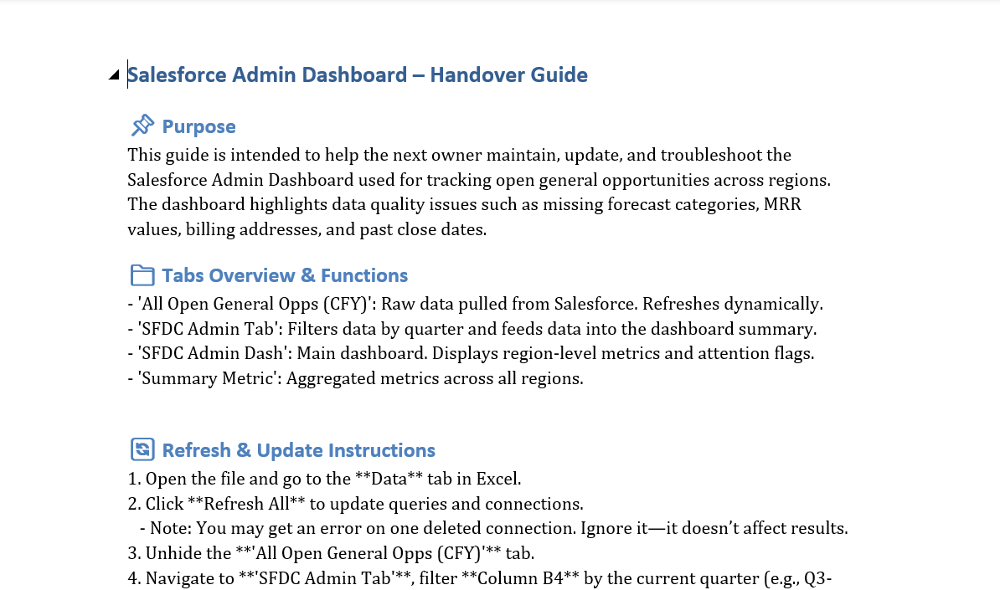

# SAP Emarsys: the file leadership used to check Salesforce, rebuilt from scratch

*SAP Emarsys · Revenue Operations Analyst (12 month placement) · Oct 2024 to Oct 2025*

**Sales leadership used one file to check how clean Salesforce was. It was built in 2022 and had stopped keeping up. I rebuilt it.**

[Back to the portfolio](https://adeadelaja.github.io) · [All case studies](../README.md)

> **Cleaned file:** real names, figures and records are replaced with synthetic data of the same structure. The tabs, columns and formulas are the real work.

## The ask

Leadership needed to know, region by region, whether the pipeline in Salesforce could be trusted.

The 2022 file couldn't keep up, so the checks either took a manual sweep or didn't happen.

## What I did

**1. Rebuilt it.** I rebuilt the file from scratch. It pulls the open opportunities for the quarter and checks the five things leadership kept asking about: forecast category, forecast MRR, billing address, BP ID and close dates that had already passed.

**2. One word per region.** Each check has a threshold, and every region comes out as one word: REVIEW or FAIR. Leadership reads one table instead of five exports.

**3. Built to run.** Around 3,000 formulas sit behind it, built on COUNTIFS, VLOOKUP, ISBLANK and AND. The whole file moves to a new quarter from one cell.

**4. Handover.** I wrote the refresh steps and a handover guide: what each tab does, how to refresh, what can break and how to check it.

## Around the files

Every day I delivered the forecast files sales leadership worked from, and I wrote the forecast notes from the weekly forecast calls. One week's notes covered 49 live deals across five regions. I supported deal teams and worked with sales and operations on everything revenue operations touched.

## What came out of it

Leadership could see straight away which region needed attention. Compared with the 2022 file, global pipeline hygiene went up 5%. The file kept running after I left.

## The evidence

*Five checks, seven regions, one verdict each. Synthetic data, real structure.*

*The handover guide.*

## The files

* [SAP_SFDC_Admin_Dashboard_CLEANED.xlsx](files/SAP_SFDC_Admin_Dashboard_CLEANED.xlsx): The dashboard, rebuilt with synthetic opportunities.

GitHub can't open Excel or Word files in the browser. Use the download button on the file page to open them.

## Not shown

Anything from SAP's systems: account names, owners, deal values and the forecast notes.

## Skills

Salesforce · Advanced Excel · COUNTIFS · Dashboard design · Data quality · Reporting to leadership · Handover documentation
