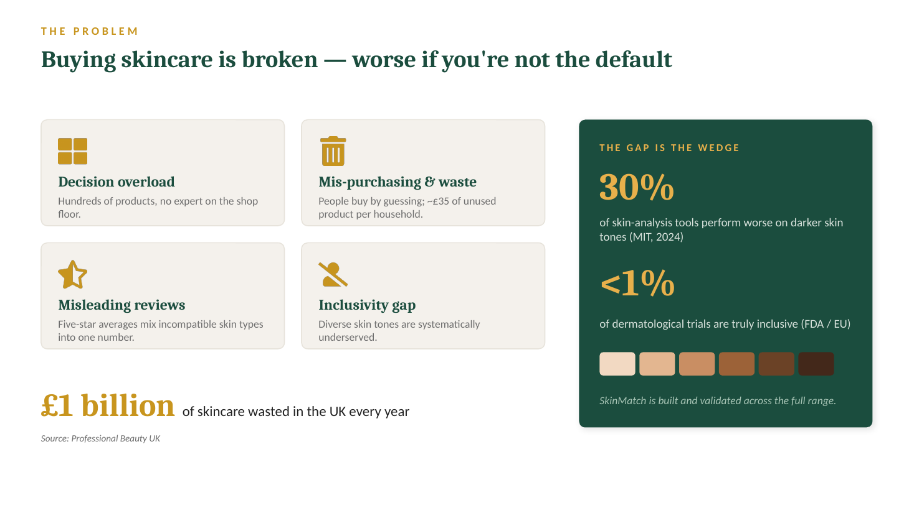
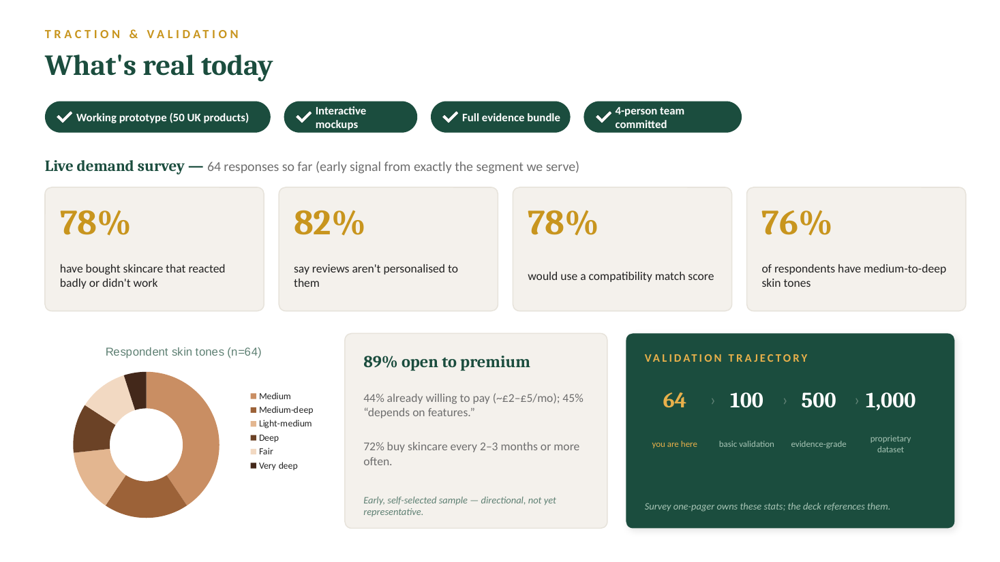
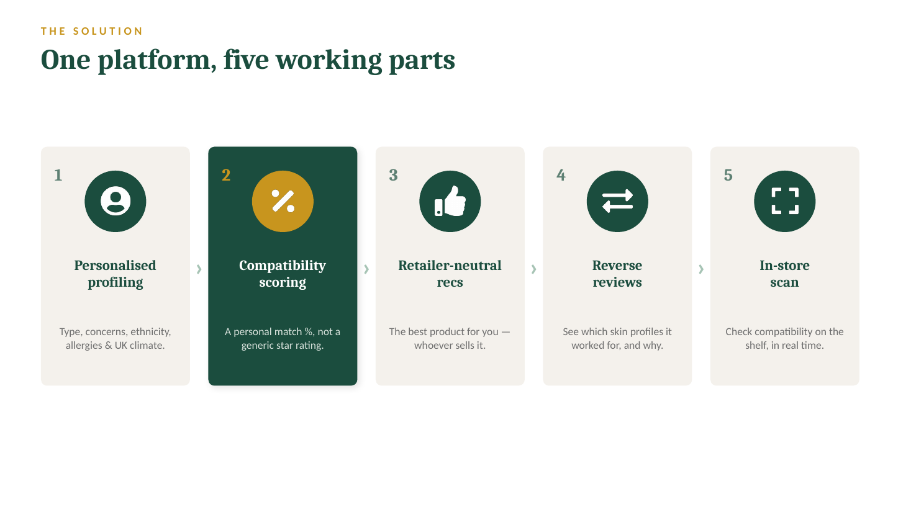
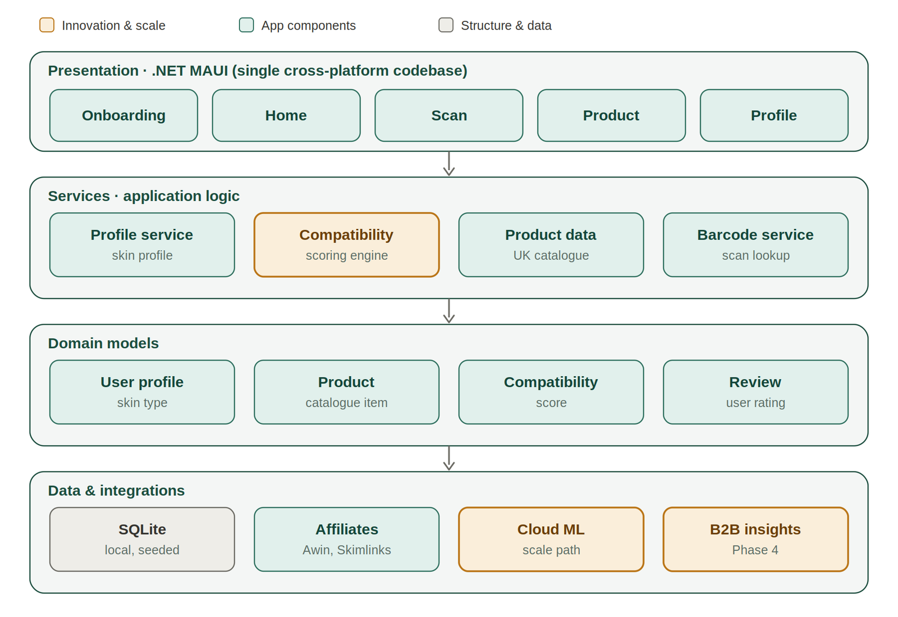
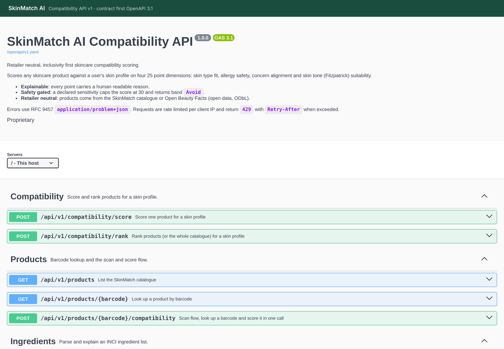
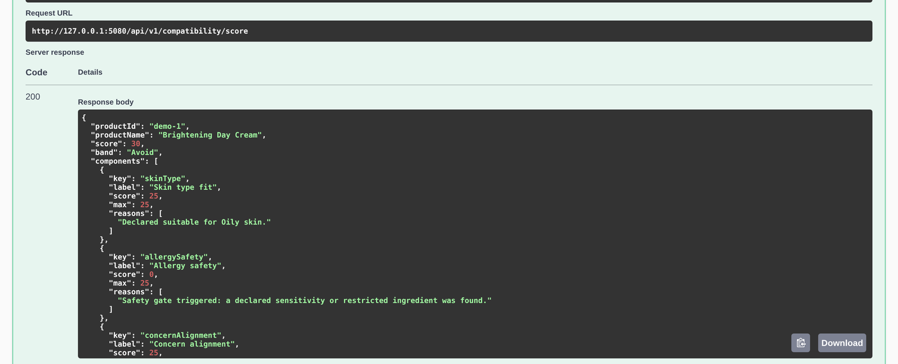
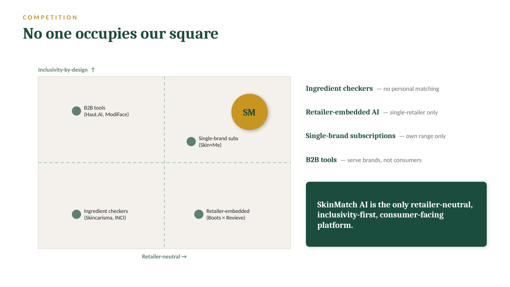

# SkinMatch AI: from an idea to a funded build

*Harize Global · 2026 · Technical Business Analyst*

**A skincare idea, a long AI chat and no data. I built everything the business needed to get to a working prototype and £10k of pre seed funding.**

[Back to the portfolio](https://adeadelaja.github.io) · [All case studies](../README.md)

## The ask

The founders had a strong idea: help people buy skincare that actually works for their skin, especially darker skin tones that most tools get wrong.

What they had was one long AI conversation. No market data, no customer evidence, no product definition, and nothing an investor could check.

## What I did

**1. Market.** I sized the market from published sources: UK skincare at US$4.59B in 2025, growing to US$6.27B by 2031, with around 45% of sales already online. I mapped five competitors, from ingredient checkers to retailer apps, and found the gap none of them covered: recommendations that are neutral across retailers and built for every skin tone.

**2. Customers.** I designed the user survey from scratch and grew it to 100 organic responses. In the first 64: 78% had bought skincare that reacted badly or didn't work, 81% felt reviews and recommendations weren't personal to them, and 78% said they would use an app that scored products for their skin. Most respondents had medium to deep skin tones, which is exactly the customer the product is for.

**3. Requirements.** I turned the research and the founders' meetings into requirements: five working parts. Skin profiling, a compatibility score, retailer neutral recommendations, reviews grouped by skin profile, and in store scanning.

**4. Architecture.** I designed the technical architecture in four layers (presentation, services, domain models, data and integrations) and wrote it up so an engineer could pick it up, with every part traced back to the business need it serves.

**5. Prototype.** I directed the build of a working prototype through an AI assisted workflow: an explainable scoring engine where every point has a reason, a REST API with a documented contract, and a mobile app, covered by 241 automated tests.

**6. Plan and pitch.** I pulled it all into one business plan, a 36 month financial model and a 13 slide pitch deck. Every figure is owned by one document and referenced everywhere else, so they never contradict each other.

## What came out of it

£10k of pre seed was committed to the engineering build.

One analyst, with AI as the working layer, doing what would normally take a research team, a product team and a finance team. From the first research to an investor ready pack took about six weeks.

## The evidence

*The problem, from the pitch deck.*

*Survey results in the deck, taken at 64 of the 100 responses.*

*The five working parts that came out of requirements.*

*The four layer architecture.*

*The prototype's API, documented from a hand written contract.*

*A live score. Every point traces to a reason.*

*Competitor map: nobody else was retailer neutral and built for every skin tone.*

## Not shown

The survey responses (they contain personal details), the financial model's figures, the business plan and the founders' private documents.

## Skills

Market research · Survey design · Customer analysis · Requirements gathering · Solution architecture · Prototyping · Business planning · AI assisted delivery
