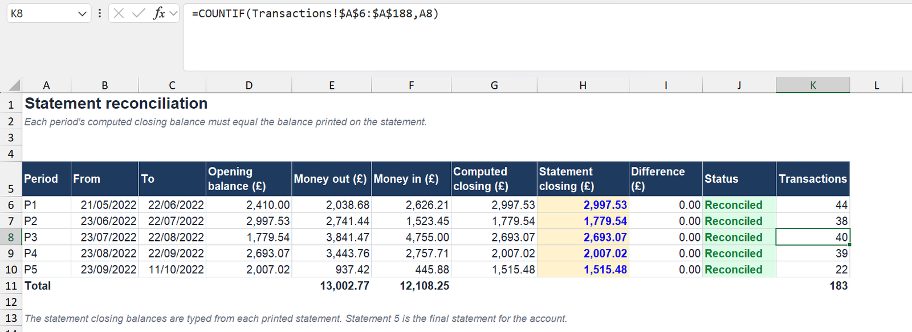
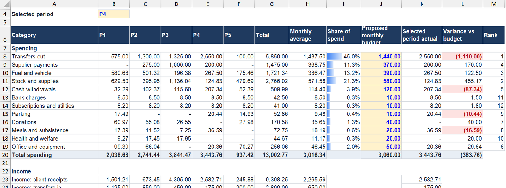

# Transfuse Analytics: from a paper bank statement to a budget

*Transfuse Analytics · Data Analyst · Remote · 2021 to 2022*

**An accountancy team needed to budget from five paper bank statements. I turned them into data they could trust.**

[Back to the portfolio](https://adeadelaja.github.io) · [All case studies](../README.md)

> **Cleaned file:** real names, figures and records are replaced with synthetic data of the same structure. The tabs, columns and formulas are the real work.

## The ask

An accountancy team needed to budget from a client's business account.

All they had was five monthly paper statements: 13 scanned pages, 183 transactions. Nobody could filter it, total it or ask it a question.

## What I did

**1. Structured.** I rebuilt the statements in Excel, one row per transaction, with a running balance and a total for every statement period.

**2. Reconciled.** I reconciled each of the five periods to the closing balance printed on the statement, so the team knew every number was right before they used it.

**3. Made it usable.** The cleaned file in this folder shows how the structure was used: keyword rules that put every transaction in a category, a budget by category and period, and checks that prove the ledger ties out.

## What came out of it

The accountancy team budgeted and made decisions from it. Getting the structure right first is what made automating it possible later.

## The evidence

*Five statement periods, each reconciled. Synthetic transactions, same structure.*

*Spend by category and period against a proposed budget.*

## The files

* [Transfuse_Bank_to_Budget_CLEANED.xlsx](files/Transfuse_Bank_to_Budget_CLEANED.xlsx): Synthetic transactions in the original five period structure, with the category and budget tabs.

GitHub can't open Excel or Word files in the browser. Use the download button on the file page to open them.

## Not shown

The client's real statements and account details.

## Skills

Advanced Excel · Data structuring · Reconciliation · SUMIFS · Budget reporting
